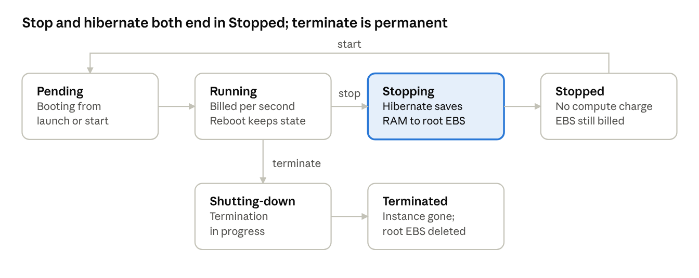

A tight reference on Amazon EC2 — the building blocks every instance is assembled from, how AMIs and instance types actually behave, the user-data and metadata gotchas that bite in exams, and the interview questions interviewers lean on.

## What EC2 is

**Amazon EC2 (Elastic Compute Cloud)** gives you virtual servers — called **instances** — that you can launch in minutes, resize and terminate. AWS manages the hardware; you manage everything from the operating system up.

Every instance is assembled from the same building blocks:

| Building block | What it decides |
| --- | --- |
| **AMI** | Operating system and pre-installed software |
| **Instance type** | CPU, memory, network and storage capacity |
| **Storage** | EBS volumes (persistent) and, on some types, instance store (temporary) |
| **Network** | VPC, subnet, public IP, security groups |
| **Key pair** | SSH or RDP login (or use Session Manager with no keys) |
| **IAM role (instance profile)** | AWS permissions for software on the instance |
| **User data** | Script that runs at first boot |

**Billing basics:** most Linux and Windows instances are billed **per second** (60-second minimum) while running. A **stopped** instance has no compute charge, but its **EBS volumes and Elastic IPs are still billed**.

## AMIs (Amazon Machine Images)

An **AMI** is the template an instance boots from — an operating system plus whatever software and configuration were baked in.

**An AMI contains:**

- **Snapshots** of the root volume (and any extra volumes).
- **Launch permissions:** who can use it (private, specific accounts, or public).
- **A block device mapping:** which volumes to attach, and their sizes and types.
- **Architecture:** `x86_64` or `arm64` (Graviton). It must match the instance type.

**Where AMIs come from:**

- **AWS-provided:** Amazon Linux 2023, Ubuntu, Windows Server and others.
- **AWS Marketplace:** vendor images, often with software licensing included.
- **Community AMIs:** public images from anyone. Use with care.
- **Your own custom AMIs:** built from an instance you configured.

**Rules worth memorising:**

- **AMIs are regional.** An AMI ID exists in one region only. To use it elsewhere, **copy** it (which creates a new AMI ID in the target region).
- **Sharing:** add other account IDs to launch permissions. For an AMI encrypted with a **customer-managed KMS key**, you must also share the key.
- **Encryption:** you can encrypt an unencrypted AMI's snapshots when copying it.
- Creating an AMI **reboots the instance by default** so the file system is consistent. The *"no reboot"* option is faster but risks an inconsistent image.
- **Deregistering an AMI doesn't delete its snapshots.** Delete them separately, or you keep paying for storage.
- **EBS-backed vs instance store-backed:** almost all modern AMIs are EBS-backed, so instances can be **stopped and started**. Instance store-backed instances can only be **rebooted or terminated**.

## Instance types and sizes

The **instance type** decides the hardware: vCPUs, memory, network bandwidth and storage options. The name tells you most of it.

**Reading a name, using `m7g.2xlarge`:**

- `m` = family (general purpose)
- `7` = generation (higher is newer, usually better price-performance)
- `g` = attribute (Graviton, AWS's ARM processor)
- `2xlarge` = size

**Common attribute letters:** `a` AMD · `i` Intel · `g` Graviton · `d` local NVMe instance store · `n` enhanced networking · `e` extra memory or storage.

**Families to know:**

| Category | Families | Good for |
| --- | --- | --- |
| **General purpose** | M, T | Web servers, app servers, dev environments |
| **Compute optimised** | C | Batch processing, high-traffic web, gaming, media encoding |
| **Memory optimised** | R, X | In-memory databases and caches, big data analytics |
| **Storage optimised** | I, D | High IOPS databases, data warehouses, distributed file systems |
| **Accelerated computing** | P, G, Inf, Trn | ML training and inference, graphics |

> **Memory aid:** **C** = compute, **R** = RAM, **I** = IOPS, **G/P** = GPU.

**Sizes** go `nano, micro, small, medium, large, xlarge, 2xlarge` and up. Within a family, each step up roughly **doubles** vCPUs, memory and price.

**Burstable instances (T family):**

- Run at a **baseline CPU level** and earn **CPU credits** while below it; they spend credits to burst higher.
- When credits run out in **standard mode**, CPU drops to the baseline. In **unlimited mode** (the default for T3 and T4g), they keep bursting and you pay for the extra.
- Good for **spiky, mostly idle** workloads. Bad for sustained high CPU.

**Graviton (`arm64`):** AWS cites up to **40% better price-performance** than comparable x86 instances. Your software and AMI must support ARM.

**Changing the instance type (EBS-backed):** stop the instance, change the type, start it. The new type must support the AMI's architecture and drivers.

## Launching an instance and creating an AMI

Launching an instance is choosing each building block in turn; creating an AMI captures a configured instance so you can launch identical copies.

**Launch steps:**

1. Choose an **AMI** (for example, Amazon Linux 2023).
2. Choose an **instance type** (for example, `t3.micro`).
3. Pick or create a **key pair**, or plan to connect with Session Manager.
4. **Network:** VPC, subnet, auto-assign public IP, security group.
5. **Storage:** root volume size and type (`gp3` is the usual default).
6. **Advanced details:** IAM instance profile, user data, hibernation, IMDSv2.
7. **Launch**, then connect and verify.

**Creating an AMI from that instance:**

- Install and configure your software on the instance.
- Choose **Actions → Image and templates → Create image**.
- AWS reboots the instance (unless you choose no reboot), snapshots its volumes and registers the AMI.
- Launch new instances from the AMI; they start with everything already installed.

> **The golden AMI pattern:** build one hardened, patched, pre-configured AMI per application, and launch every instance (usually through an Auto Scaling group's launch template) from it. Instances boot fast and identically. Automate building and patching it with **EC2 Image Builder** or **Packer** instead of doing it by hand.

**Launch templates** store all launch settings (AMI, type, security groups, user data and more) as a versioned template. Auto Scaling groups use them, and they're the modern replacement for launch configurations.

## User data and instance metadata

**User data** is a script (or cloud-init configuration) you pass at launch that runs automatically when the instance first boots. It's how you bootstrap software without logging in.

**Example for Amazon Linux:**

```bash
#!/bin/bash
dnf update -y
dnf install -y nginx
systemctl enable --now nginx
echo "Hello from $(hostname)" > /usr/share/nginx/html/index.html
```

**Rules to know:**

- **Runs once, at first boot** by default. Rebooting or stop/start doesn't rerun it unless you configure cloud-init to run per boot.
- **Runs as root**, so no `sudo` is needed.
- Processed by **cloud-init** on Linux (**EC2Launch** on Windows). Check `/var/log/cloud-init-output.log` when a script fails.
- **16 KB limit** for the raw data.
- Editing it requires **stopping the instance**, and the change won't run on the next start by default.
- **Not secret.** Anyone or any process that can query the instance metadata can read it. Fetch secrets at boot from **Secrets Manager** or **Parameter Store** using the instance's IAM role instead.

**Instance metadata (IMDS)** is a local endpoint at `http://169.254.169.254/latest/` where software on the instance can read its instance ID, AZ, IPs, user data and the temporary credentials of its IAM role.

- **Use IMDSv2 and make it required.** IMDSv2 needs a session token from a `PUT` request first, which blocks most **server-side request forgery (SSRF)** attacks that could otherwise steal the role's credentials.
- **Hop limit:** set to `2` when containers on the instance need metadata access.

**Bake vs bootstrap:**

| | Bake into a golden AMI | Bootstrap with user data |
| --- | --- | --- |
| **Boot speed** | Fast; everything pre-installed | Slower; installs at every launch |
| **Flexibility** | Rebuild the AMI to change anything | Edit the script or launch template |
| **Consistency** | Identical images | Depends on package repos at boot time |
| **Common practice** | Heavy, stable software | Light, environment-specific config |

Most teams combine them: **bake the heavy, stable layers** into the AMI and **use user data for small environment-specific settings**.

## Hibernate and the instance lifecycle

**Hibernation** is a special kind of stop: EC2 saves the instance's RAM to its **root EBS volume**, then stops it. On the next start, memory is restored, so running processes and in-memory data pick up where they left off.



**Requirements:**

- **Enabled at launch.** You can't turn it on for an existing instance.
- **EBS root volume, encrypted**, with enough free space to hold all the RAM.
- **RAM under 150 GB**, on a supported instance family and AMI (most current general purpose, compute and memory optimised types).
- At most **60 days** in hibernation.
- **Billing:** you pay while it's stopping (writing RAM to disk), then only for EBS and Elastic IPs while hibernated.

**Use cases:** apps that take a long time to start or warm caches, and long-running processes you want to pause rather than restart.

**Stop vs hibernate vs reboot vs terminate:**

| | Reboot | Stop | Hibernate | Terminate |
| --- | --- | --- | --- | --- |
| **RAM contents** | Lost (OS restarts) | Lost | Saved to root EBS | Lost |
| **EBS data** | Kept | Kept | Kept | Root deleted by default; extra volumes kept |
| **Instance store data** | Kept | Lost | Lost | Lost |
| **Instance ID** | Same | Same | Same | Gone |
| **Private IPv4** | Same | Same | Same | Released |
| **Public IPv4 (non-Elastic)** | Same | Changes | Changes | Released |
| **Underlying host** | Same | Usually new | Usually new | — |
| **Compute billing** | Continues | Stops | Stops after hibernating | Stops |

## Exam traps and key facts

- **AMIs are regional.** Launching in another region means copying the AMI first; the copy gets a new AMI ID.
- Sharing an **encrypted AMI** requires sharing the customer-managed KMS key too. AMIs encrypted with the AWS-managed key can't be shared.
- **Deregistering an AMI** leaves its snapshots, which keep costing money.
- **AMI architecture must match the instance type:** an `arm64` AMI won't run on an `x86` type, and vice versa.
- **Pick the family from the workload:** in-memory cache → **R**; CPU-heavy batch → **C**; high random I/O → **I**; ML/GPU → **P** or **G**; spiky low-traffic → **T**.
- **T instances slow down** when CPU credits run out in standard mode. Sustained high CPU on T is usually the wrong choice.
- **User data runs once at first boot as root.** It doesn't rerun on reboot or stop/start by default.
- **Don't put secrets in user data;** it's readable through instance metadata.
- **Require IMDSv2** to protect role credentials from SSRF.
- **Hibernate must be enabled at launch;** it can't be turned on for a running instance.
- Hibernate needs an **encrypted EBS root volume big enough to hold the RAM**, and RAM under 150 GB.
- **Instance store data is lost on stop, hibernate and terminate;** it survives only reboots.
- **Root EBS volume is deleted on terminate by default;** additional EBS volumes are kept by default.
- **Public IPv4 changes after stop/start or hibernate;** use an **Elastic IP** to keep it.

## Interview questions with model answers

Interviewers want to hear how you'd run EC2 in production, not just definitions.

**1. AMI vs snapshot vs launch template — what's the difference?**
A **snapshot** is a point-in-time backup of **one EBS volume**. An **AMI** is a **bootable image** built from one or more snapshots plus launch metadata. A **launch template** is a **full set of launch settings** (AMI, instance type, network, user data and more) that Auto Scaling groups and people use to launch consistently.

**2. How do you choose an instance type?**
Start from the workload's bottleneck: CPU-bound → **C** family, memory-bound → **R**, I/O-bound → **I**, GPU → **G** or **P**, general → **M**, spiky and mostly idle → **T**. Prefer the newest generation and consider **Graviton** for better price-performance if the software supports ARM. Then **right-size with real CloudWatch metrics** rather than guessing.

**3. Golden AMI or user data for configuring servers?**
**Both, for different layers.** Bake heavy, stable software and security hardening into an AMI built by a pipeline (Image Builder or Packer), so instances boot fast and identically — which matters for auto scaling. Use **user data for small environment-specific settings**. Long user data scripts slow scale-out and can fail if a package repository is down.

**4. Your user data script didn't work. How do you troubleshoot?**
Check `/var/log/cloud-init-output.log` for the error. Common causes: a missing `#!/bin/bash` line, a typo, no outbound internet (no NAT or route) so package installs fail, a missing IAM permission, or expecting it to rerun after reboot when it only runs at first boot.

**5. When would you use hibernation?**
When **startup is slow and in-memory state is valuable** — for example, an app that takes a long time to load data or warm caches. Hibernation saves RAM to the encrypted root volume and restores it on start, so processes resume. It must be enabled at launch and needs enough root volume space for the RAM.

**6. How do you secure EC2 credentials and metadata?**
**No access keys on instances:** use an **IAM role** with least privilege. **Require IMDSv2** so SSRF bugs can't easily steal the role's credentials. Keep secrets out of user data and fetch them from **Secrets Manager** or **Parameter Store**. Prefer **Session Manager** over open SSH ports.

**7. How do you change an instance's type with minimal risk?**
For EBS-backed instances: **stop, change type, start**. Check the new type supports the AMI's architecture and drivers (ENA, NVMe). The public IP changes unless you use an **Elastic IP** or a load balancer. In production, **roll the change through the launch template and Auto Scaling group** instead of editing instances by hand.

## Active recall drill

Review on days 1, 3, 7, 14 and 30, answering from memory first.

- **What does an AMI contain?** → Volume snapshots, launch permissions, block device mapping, architecture
- **Are AMIs global or regional?** → Regional; copy to use in another region
- **What happens to snapshots when you deregister an AMI?** → Nothing; delete them separately
- **What does each part of `m7g.2xlarge` mean?** → `m` family, `7` generation, `g` Graviton, `2xlarge` size
- **Family for an in-memory cache? For CPU-heavy batch?** → R; C
- **What happens when a T instance runs out of CPU credits?** → Standard mode: throttles to baseline. Unlimited mode: keeps bursting for extra cost
- **When does user data run?** → Once, at first boot, as root
- **Size limit of user data?** → 16 KB
- **Where do you check user data failures?** → `/var/log/cloud-init-output.log`
- **Why require IMDSv2?** → Session tokens block SSRF theft of role credentials
- **Hibernate requirements?** → Enabled at launch, encrypted EBS root big enough for RAM, RAM under 150 GB
- **Max hibernation period?** → 60 days
- **Which survives a stop: EBS data or instance store data?** → EBS data
- **Does a stopped instance keep its public IPv4?** → No; use an Elastic IP

## Hands-on drill (~60 minutes)

- ☐ Launch a `t3.micro` Amazon Linux instance with the nginx user data script above; confirm the page loads from its public IP
- ☐ Read the user data through IMDSv2: get a token with a `PUT` request, then query `latest/user-data`
- ☐ Read `/var/log/cloud-init-output.log`; then break the script on purpose, launch again and find the error
- ☐ Create an AMI from the instance, launch a second instance from it with no user data, and confirm nginx is already there
- ☐ Launch an instance with hibernation enabled and an encrypted root volume; start a long-running process, hibernate, start again, and confirm the process survived with the same instance ID
- ☐ Stop an instance and note that the public IP changed
- ☐ Clean up: terminate instances, deregister the AMI and delete its snapshots
