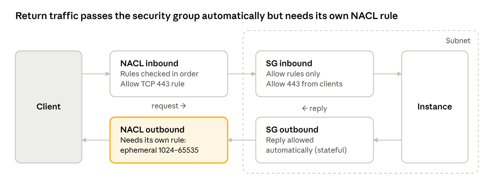

AWS gives you two firewalls (security groups and NACLs) plus a quiet third thing (DHCP option sets) that most people only touch once. What each does, how they stack, the gotchas that break traffic, and the interview questions interviewers lean on.

## Security groups

A **security group** is a *stateful*, *allow-only* firewall attached to a network interface — so effectively to an instance, load balancer, RDS database or Lambda in a VPC. It's your main access control in AWS.

**How it works:**

- **Stateful.** If a request is allowed in, the reply is allowed out automatically, and vice versa. You never write rules for return traffic.
- **Allow rules only.** There are no deny rules. Anything not explicitly allowed is denied.
- **No rule order.** All rules are evaluated together; if any rule allows the traffic, it's allowed.
- Each rule has a **protocol, a port range** and a **source (inbound) or destination (outbound)**: a CIDR block, a prefix list, or another security group.
- Changes apply **immediately** to existing and new connections.

**Defaults:**

- A **new** security group allows **no inbound** traffic and **all outbound** traffic.
- The **VPC's default** security group allows inbound traffic **only from instances in the same group**, plus all outbound.

> **Referencing other security groups is the key design pattern.** Instead of *"allow 5432 from `10.0.11.0/24`"*, write *"allow 5432 from the app tier's security group"*. The rule then follows instances as they scale in and out or change IPs.

**Scope and limits:**

- A security group belongs to one VPC (and therefore one region). You can reference a security group in a peered VPC in the same region.
- **5 security groups per network interface** by default (adjustable).
- **60 inbound and 60 outbound rules** per security group by default (adjustable).
- Security groups don't filter traffic to the **Amazon DNS server, instance metadata (`169.254.169.254`) or DHCP**.

## Network ACLs (NACLs)

A **network ACL** is a *stateless* firewall at the subnet boundary, with numbered **allow and deny** rules. It's an optional extra layer on top of security groups.

**How it works:**

- **Stateless.** Inbound and outbound are judged separately. If you allow a request in, you must also allow the reply out.
- **Allow *and* deny rules.** This is the only VPC firewall that can explicitly deny.
- **Ordered evaluation.** Rules are checked from the lowest number up (1 to 32766); the **first match wins** and the rest are skipped. A final `*` rule denies anything that matched nothing.
- Number rules in **steps of 10 or 100** so you can insert rules later.

**Example inbound rules for a public web subnet:**

| Rule # | Type | Port | Source | Action |
|---:|---|---|---|---|
| 90 | All traffic | All | `203.0.113.50/32` | **DENY** |
| 100 | HTTPS | 443 | `0.0.0.0/0` | ALLOW |
| 110 | Custom TCP | 1024–65535 | `0.0.0.0/0` | ALLOW |
| `*` | All traffic | All | `0.0.0.0/0` | **DENY** |

Rule 90 blocks one bad IP *before* rule 100 can allow it. Rule 110 lets in the replies to connections the subnet started.

**Default vs custom:**

- The **default NACL** (created with the VPC) allows **all** inbound and outbound traffic.
- A **custom NACL** you create **denies all** inbound and outbound traffic until you add rules.

**Associations:**

- Each subnet is associated with **exactly one** NACL. One NACL can serve many subnets.
- Subnets without an explicit association use the default NACL.

**Ephemeral ports:** a client picks a random high port for its side of a connection, and replies go back to that port. Linux uses `32768–60999`, Windows `49152–65535`, and NAT gateways `1024–65535`. **Allowing `1024–65535` covers them all.**

**Other facts:**

- NACLs don't filter traffic between instances in the same subnet; they act only at the subnet boundary.
- **20 inbound and 20 outbound rules** per NACL by default (adjustable).

## Security group vs NACL

Use security groups as the main control and NACLs as an optional subnet-wide guardrail; the biggest practical difference is that **NACLs are stateless.**

| | Security group | Network ACL |
|---|---|---|
| **Applies to** | Network interface (instance) | Subnet |
| **State** | Stateful | Stateless |
| **Rule types** | Allow only | Allow **and** deny |
| **Evaluation** | All rules together | In number order, first match wins |
| **Return traffic** | Allowed automatically | Needs an explicit rule |
| **Default (new)** | No inbound, all outbound | Custom: deny all; default NACL: allow all |
| **Can reference** | CIDRs, prefix lists, other security groups | CIDRs only |
| **Per resource** | Up to 5 per interface | Exactly 1 per subnet |
| **Typical use** | Tier-to-tier access control | Blocking IP ranges, subnet guardrails |

A request passes the NACL at the subnet edge, then the instance's security group. The reply leaves through the security group **without a rule**, but the NACL checks it again as new outbound traffic — so it needs the ephemeral port rule.

## DHCP option sets

A **DHCP option set** is the network configuration a VPC hands to every instance when it boots — mainly which DNS servers to use and which domain name to append.

**What you can set:**

| Option | What it controls | Default |
|---|---|---|
| `domain-name-servers` | DNS servers instances use (up to 4) | `AmazonProvidedDNS` |
| `domain-name` | Suffix appended to short hostnames | `ec2.internal` in us-east-1; `region.compute.internal` elsewhere |
| `ntp-servers` | Time servers | None (Amazon Time Sync is used anyway) |
| `netbios-name-servers`, `netbios-node-type` | Legacy Windows name resolution | None |

**Rules:**

- **One option set per VPC** at a time; one option set can be associated with many VPCs in the same region.
- **Option sets can't be edited.** To change settings, create a new set and associate it with the VPC.
- **No relaunch needed.** Running instances pick up the new settings when their DHCP lease renews; you can force this by restarting the network service or rebooting.
- The DNS *attributes* are separate: "DNS resolution" and "DNS hostnames" are VPC settings, not DHCP options.

**Typical use case:** a hybrid environment where instances must resolve names through on-premises DNS, such as Active Directory domain controllers. You create an option set pointing at those DNS servers with your corporate domain name.

> **The catch:** if you replace `AmazonProvidedDNS` with your own servers, instances lose direct access to AWS DNS features such as Route 53 private hosted zones, unless your DNS servers forward to AWS. For hybrid DNS, **Route 53 Resolver inbound and outbound endpoints** are usually the cleaner modern answer.

## Exam traps and key facts

Most questions here test statefulness, deny rules or rule order.

- **"Block a specific IP address"** → NACL deny rule. Security groups can't deny. (For HTTP-level blocking on a load balancer or CloudFront, **AWS WAF** is the other valid answer.)
- **Connections fail after adding a custom NACL** → it denies everything by default, or the outbound ephemeral port rule (`1024–65535`) is missing.
- **NACL rule order matters:** a DENY at rule 200 never fires if an ALLOW for the same traffic exists at rule 100.
- **Security group rule order doesn't matter:** all rules are combined, and the most permissive one applies.
- **Inbound traffic hits the NACL first, then the security group;** outbound leaves through the security group first, then the NACL.
- **Default NACL allows all; custom NACL denies all.** New security group: no inbound, all outbound.
- **Allow traffic only from the web tier** → reference the web tier's security group as the source, not its CIDR.
- NACLs are per subnet; security groups are per network interface. Two instances in the same subnet can have different security groups but always share the NACL.
- NACLs don't filter traffic within a subnet.
- **DHCP option sets can't be modified;** create a new one and associate it.
- **Custom DNS for instances** → a DHCP option set with your DNS servers.

## Interview questions with model answers

Say these aloud in your own words; follow-ups usually probe statefulness and real troubleshooting.

**1. Security group vs NACL?**
Security groups attach to network interfaces, are stateful and allow-only, with all rules evaluated together. NACLs attach to subnets, are stateless, support deny and are evaluated in rule-number order. Security groups are the primary control; NACLs are a coarse subnet-wide guardrail.

**2. Explain stateful vs stateless with an example.**
A client connects to a web server on 443 from port 51000. A security group allowing inbound 443 automatically lets the reply out to port 51000. A NACL needs an inbound rule for 443 **and** a separate outbound rule allowing ports `1024–65535` for the reply.

**3. You added a custom NACL and the website stopped working. Why?**
A new custom NACL denies everything until rules are added. Even with inbound 443 allowed, replies are blocked unless outbound ephemeral ports are allowed. I'd check both directions and the rule order.

**4. How do you block one malicious IP?**
Add a NACL deny rule for that IP with a lower number than any rule that would allow it. Security groups can't deny. If the traffic is HTTP through a load balancer or CloudFront, AWS WAF is often the better tool.

**5. How would you design security groups for a 3-tier app?**
Three groups chained by reference. The load balancer group allows 443 from the internet. The app group allows the app port only from the load balancer group. The database group allows 5432 only from the app group. No tier is reachable except through the one in front of it, and the rules survive scaling and IP changes.

**6. Your EC2 instances must resolve names in your on-premises Active Directory domain. How?**
Either create a DHCP option set pointing at the AD DNS servers with the corporate domain name, or keep `AmazonProvidedDNS` and use Route 53 Resolver outbound endpoints with forwarding rules for the corporate domain. The Resolver option keeps private hosted zones working and is usually preferred.

**7. You associated a new DHCP option set, but an instance still uses the old DNS server. Why?**
Instances get DHCP settings when their lease renews. Renew the lease, restart networking or reboot; there's no need to relaunch.

## Active recall and hands-on drill

Review on day 1, 3, 7, 14 and 30, answering from memory first. Prompts are in question :: answer form for spaced repetition.

- Security group: stateful or stateless? :: **Stateful**; return traffic is allowed automatically
- NACL: stateful or stateless? :: **Stateless**; return traffic needs its own rule
- Which can deny traffic, SG or NACL? :: Only the NACL
- How are NACL rules evaluated? :: Lowest number first; first match wins
- How are security group rules evaluated? :: All together; any allow permits the traffic
- Default NACL vs new custom NACL? :: Default allows all; custom denies all
- New security group defaults? :: No inbound; all outbound allowed
- Ephemeral port range to allow on a NACL? :: `1024–65535`
- Inbound traffic order through the layers? :: NACL first, then security group
- Best way to allow DB access only from the app tier? :: Reference the app tier's security group as the source
- Can you edit a DHCP option set? :: No; create a new one and associate it
- Default DNS in a DHCP option set? :: `AmazonProvidedDNS`

**Hands-on drill (about 45 minutes, matching the course demo):**

- Launch a web server in a public subnet with a security group allowing 80 and 22 from your IP; confirm it works.
- Create a custom NACL, associate it with the subnet, and watch everything break.
- Add inbound 80 and 22, then outbound `1024–65535`, testing after each step to see the stateless behaviour.
- Add a NACL deny for your own IP at a lower rule number and confirm you're blocked; then remove it.
- Create a second instance with a security group that allows SSH only from the first instance's security group.
- Create a DHCP option set with a custom domain name, associate it, renew the lease, and check `/etc/resolv.conf`.
- Restore the default NACL and option set, then clean up.
