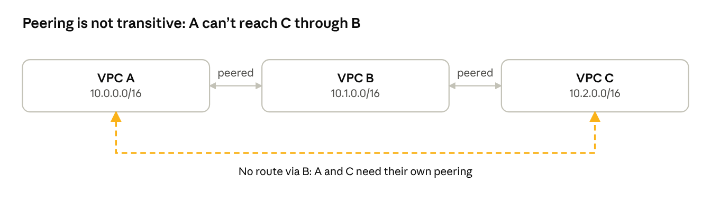
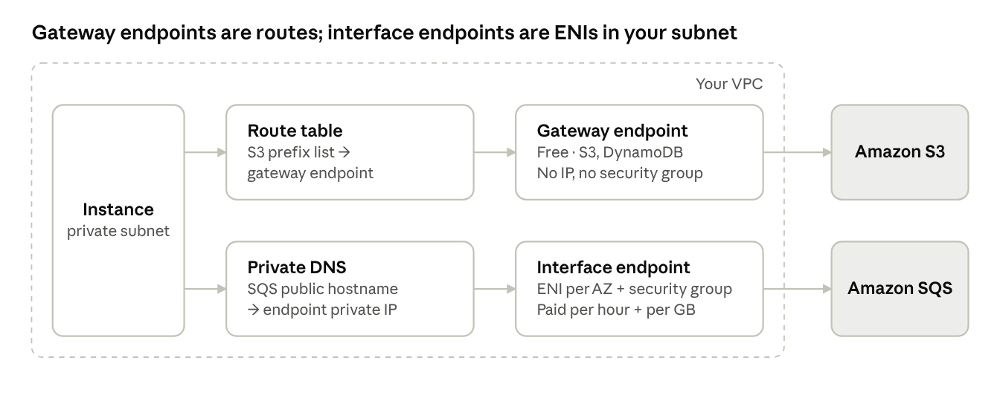

Four pieces of AWS networking that most "which service do I pick" questions actually hinge on — VPC peering, NAT gateways, VPC endpoints, and AWS PrivateLink. What each one is, when to reach for it, the gotchas that trip people up, and the interview questions interviewers lean on.

## VPC peering

**VPC peering** is a private, one-to-one network connection between two VPCs — resources in each can talk over private IPs, over the AWS backbone, never the internet.

**What it supports:**

- Same or different accounts, same or different regions (inter-region peering is encrypted automatically).
- **No gateway in the path:** no single point of failure, no bandwidth bottleneck.
- **Cost:** no hourly charge; you pay for data transferred (free within the same AZ).

**Setup steps:**

1. The requester VPC sends a peering request (`pcx-xxxx`) to the accepter VPC.
2. The accepter's owner accepts it.
3. Add a route in both VPCs' route tables: *the other VPC's CIDR → the peering connection*.
4. Update security groups to allow the traffic. In the same region you can reference the peer's security group; across regions, use CIDRs.
5. Optionally enable DNS resolution so public DNS names of the peer's instances resolve to private IPs.

**The rules that matter most:**

- **No overlapping CIDRs** between the two VPCs.
- One peering connection per VPC pair.
- **Not transitive** (see diagram below).
- **No edge-to-edge routing:** a VPC can't use its peer's internet gateway, NAT gateway, VPN, Direct Connect or gateway endpoint.
- Limit: 50 active peering connections per VPC by default (adjustable).

Because peering isn't transitive, connecting many VPCs means a **full mesh**: *n* VPCs need `n(n−1)/2` connections. That's the problem Transit Gateway solves.

## NAT gateways

A **NAT gateway** lets instances in private subnets start **outbound** connections (to the internet or other networks) while blocking anything started from outside.

**Two types:**

| | Public NAT gateway | Private NAT gateway |
|---|---|---|
| **Placed in** | A public subnet | Any subnet |
| **Needs an Elastic IP** | Yes | No |
| **Reaches** | The internet, through the IGW | Other VPCs or on-premises, through Transit Gateway or a virtual private gateway |
| **Typical use** | Private instances downloading updates, calling APIs | Connecting networks with overlapping CIDRs |

**Setup for a public NAT gateway:**

1. Create it in a public subnet and allocate an Elastic IP to it.
2. In the private subnet's route table, add `0.0.0.0/0 →` the NAT gateway.

**Key properties:**

- **AZ-scoped.** It's redundant within its AZ but fails with the AZ. For high availability, put one in each AZ and route each private subnet to the NAT gateway in its own AZ (which also avoids cross-AZ data charges).
- **Managed scaling:** starts at 5 Gbps and scales automatically to 100 Gbps.
- **Connection limit:** about 55,000 simultaneous connections to each unique destination; add secondary IPs if you need more.
- **No security groups.** You can't attach one; control traffic with the instances' security groups and the subnet's NACL.
- **Cost:** charged per hour **plus** per GB processed. Data-heavy traffic to S3 or DynamoDB through NAT is a classic hidden cost — gateway endpoints fix it.
- **IPv6:** NAT gateways are for IPv4. For outbound-only IPv6, use an **egress-only internet gateway**.

**NAT gateway vs NAT instance** (the legacy option):

| | NAT gateway | NAT instance |
|---|---|---|
| **Managed by** | AWS | You (an EC2 instance) |
| **Availability** | Highly available within the AZ | Single point of failure unless you script failover |
| **Bandwidth** | Scales to 100 Gbps | Limited by instance type |
| **Security groups** | Not supported | Supported |
| **Setup gotcha** | None | Must disable source/destination check |
| **When to pick it** | Almost always | Rarely, for very low cost in non-critical environments |

## Transit VPCs and Transit Gateway

When many VPCs and on-premises networks all need to talk, peering every pair stops scaling: *n* VPCs need `n(n−1)/2` peering connections (10 VPCs = 45). A hub-and-spoke design solves this.

**Transit VPC (legacy pattern).** A central "hub" VPC runs router or VPN appliances on EC2 (for example, Cisco or Juniper virtual routers). Every spoke VPC and the on-premises network connects to it over VPN. It works, but you own the appliances: licensing, patching, scaling and high availability are all your problem. **Know it for the exam as the old way.**

**AWS Transit Gateway (the modern answer).** A managed regional hub that you attach networks to:

- **Attachments:** VPCs, Site-to-Site VPN, Direct Connect gateways, and peering with Transit Gateways in other regions or accounts.
- **Transitive routing:** unlike peering, any attached network can reach any other, subject to Transit Gateway route tables.
- **Segmentation:** multiple Transit Gateway route tables let you isolate, for example, prod from dev while both reach shared services.
- **Sharing:** share one Transit Gateway across accounts with AWS Resource Access Manager.
- **Cost:** charged per attachment per hour plus per GB processed. Peering has no hourly charge, so it's cheaper for a few VPCs.
- **Still no overlapping CIDRs** between attachments you want to route between (unless you add private NAT).

> **Rule of thumb:** a few VPCs with simple needs → peering. Many VPCs, on-premises connectivity or central control → Transit Gateway.

## VPC endpoints and AWS PrivateLink

A **VPC endpoint** lets resources in your VPC reach AWS services **privately** — without an internet gateway, NAT gateway or VPN — and the traffic never leaves the AWS network.

**Three types:**

- **Gateway endpoints:** a route table target; **only for S3 and DynamoDB**; free.
- **Interface endpoints:** a network interface with a private IP in your subnet, powered by **AWS PrivateLink**; for most AWS services and for your own or partners' services; paid.
- **Gateway Load Balancer endpoints:** send traffic through security appliances such as third-party firewalls. Know the name for the exam.

**AWS PrivateLink** is the technology behind interface endpoints. It exposes a single service privately into a consumer's VPC, without connecting the two networks.

> **Why endpoints matter:** better security (no internet path), lower cost (less NAT gateway traffic), and they let fully private subnets with no NAT gateway still use AWS services.

## Gateway endpoints

A **gateway endpoint** gives private subnets free, private access to **Amazon S3 or DynamoDB** by adding a route, with no NAT gateway or internet gateway involved.

**How it works:**

- **Only two services:** S3 and DynamoDB.
- **It's a route table target.** When you create it, you pick route tables; AWS adds a route whose destination is the service's **managed prefix list** (`pl-xxxx`) and whose target is the endpoint (`vpce-xxxx`).
- **DNS doesn't change.** Instances keep using the normal S3 hostname; the more specific prefix-list route sends that traffic to the endpoint instead of the NAT gateway.
- **Free.** No hourly or per-GB charge, which is why it's the standard fix for high NAT costs from S3 traffic.
- **Same region only.** It reaches S3 buckets in the VPC's own region.

**Limits to know:**

- **Not reachable from outside the VPC.** On-premises networks (via VPN or Direct Connect), peered VPCs and Transit Gateway attachments can't use it. For those cases, use an S3 **interface** endpoint.
- **No security group.** To restrict outbound traffic in security groups, reference the **S3 prefix list** as the destination.

**Access control works on both sides:**

- **Endpoint policy:** a policy on the endpoint limiting which buckets or actions can be used through it — e.g. only your company's buckets.
- **Bucket policy:** conditions like `aws:SourceVpce` (this endpoint) or `aws:SourceVpc` (this VPC) to allow access **only through the endpoint**.

Together these make a common exam answer: *"the bucket must only be accessible from our VPC"*.

## Interface endpoints and PrivateLink

An **interface endpoint** is a network interface with a private IP in your subnet that acts as the private entry point to a service. It's built on **AWS PrivateLink** and works for most AWS services — SQS, SNS, ECR, Secrets Manager, KMS, CloudWatch, STS, S3 and more.

**How it works:**

- **One ENI per AZ** you choose, each with a private IP from that subnet. Pick subnets in every AZ your workloads run in.
- **Has a security group.** It must allow inbound **443** from the instances that use it — a common cause of failures.
- **Private DNS.** When enabled, the service's normal hostname (for example, the regional SQS endpoint) resolves to the endpoint's private IPs, so applications need no code change. This requires the VPC's **DNS resolution and DNS hostnames** settings to be on.
- **Reachable from outside the VPC:** on-premises over VPN or Direct Connect, and from peered or Transit Gateway–connected VPCs, given the right DNS setup (usually Route 53 Resolver).
- **Cost:** charged per hour for each AZ **plus** per GB processed.
- **Endpoint policies** work the same way as on gateway endpoints, for services that support them.

**PrivateLink for your own services** — you can publish a service the same way AWS does:

- The provider puts the service behind a **Network Load Balancer** (or Gateway Load Balancer) and creates an **endpoint service**.
- Consumers in other VPCs or accounts create interface endpoints to it; the provider can require approval of each connection.
- Traffic flows **one way**, consumer to provider, and only to that one service — not the whole VPC.
- **Overlapping CIDRs don't matter,** because there's no routing between the VPCs.

This is how many SaaS vendors on AWS offer private connectivity, and why PrivateLink is the answer when you must expose one service to many VPCs safely.

## Choosing the right connectivity option

Many exam scenarios are really *"pick the right one of these"*; the deciding details are usually scale, transitivity, overlapping CIDRs and cost.

| Need | Best fit | Why |
|---|---|---|
| Connect two or a few VPCs, full network access | **VPC peering** | No hourly charge, lowest latency |
| Connect many VPCs plus on-premises | **Transit Gateway** | Transitive hub, central routing, segmentation |
| Expose one service to many VPCs or accounts | **PrivateLink endpoint service** | One-way, service-only, overlapping CIDRs fine |
| Private subnet → S3 or DynamoDB, same region | **Gateway endpoint** | Free; removes NAT costs |
| Private access to other AWS services, or S3 from on-premises | **Interface endpoint** | Private IP in your VPC, reachable over VPN/Direct Connect |
| Private subnet → the internet, outbound only | **Public NAT gateway** | Managed, scales, blocks inbound connections |
| Two networks with overlapping CIDRs must route to each other | **Private NAT gateway** (with Transit Gateway), or re-address | Translates the overlapping addresses |

## Exam traps and key facts

- **Peering is not transitive**, and there's **no edge-to-edge routing** — a VPC can't use its peer's internet gateway, NAT gateway, VPN, Direct Connect or gateway endpoint.
- Peered VPCs can't have **overlapping CIDRs**, even partially.
- Peering needs routes on both sides **plus** security group rules. An accepted peering with no route entries passes no traffic.
- **Cross-region peering can't reference security groups;** use CIDRs.
- NAT gateway lives in a **public subnet** and needs an Elastic IP (public type). Putting it in a private subnet is a classic wrong answer.
- One NAT gateway per AZ for high availability; one shared NAT gateway is a single-AZ dependency.
- NAT gateways have **no security groups**; NAT instances do, and need source/destination check disabled.
- **Lots of S3 traffic through NAT is expensive** → add an S3 gateway endpoint.
- **Gateway endpoints:** S3 and DynamoDB only, free, route-table based, same region, **not usable from on-premises or peered VPCs**.
- **On-premises needs private access to S3** → S3 **interface** endpoint over VPN or Direct Connect.
- **Interface endpoint fails** → check its security group allows 443 from clients, private DNS is enabled, and the VPC's DNS settings are on.
- **"Only accessible from our VPC" for a bucket** → bucket policy with `aws:SourceVpce` or `aws:SourceVpc`.
- **Share a service with many VPCs with overlapping CIDRs** → PrivateLink (NLB + endpoint service).
- **Transit VPC = legacy;** Transit Gateway is the managed replacement.

## Interview questions with model answers

These questions test judgment about trade-offs, so explain *why* you'd choose an option, not just what it is.

**1. Peering, Transit Gateway or PrivateLink — how do you choose?**
Peering for a small number of VPCs that need full network access; it's cheapest with no hourly fee. Transit Gateway when there are many VPCs or on-premises networks, because it's transitive and centrally managed. PrivateLink when only **one service** needs to be shared, especially across accounts or with overlapping CIDRs, because it exposes the service without connecting the networks.

**2. VPC A is peered with VPC B, which has a NAT gateway. Can A's instances use it for internet access?**
No. Peering doesn't support edge-to-edge routing, so A can't use B's NAT gateway, internet gateway or VPN. A needs its own NAT gateway, or both VPCs need a Transit Gateway design with a central egress VPC.

**3. Our NAT gateway bill is huge. What do you check?**
First, *what's* flowing through it. Usually it's S3 or DynamoDB traffic, which a free gateway endpoint removes. Next, cross-AZ traffic to a NAT gateway in another AZ — put one in each AZ. Then other AWS API traffic like ECR image pulls, which interface endpoints can carry.

**4. How do you design NAT for high availability?**
One NAT gateway in a public subnet in each AZ, and a separate private route table per AZ pointing at the NAT gateway in the same AZ. An AZ failure then affects only that AZ's workloads.

**5. On-premises servers need private access to S3 over Direct Connect. What do you use?**
An S3 **interface** endpoint, because gateway endpoints can't be reached from outside the VPC. On-premises DNS forwards S3 names to the endpoint through a Route 53 Resolver **inbound** endpoint.

**6. We need to offer our API privately to 50 customer VPCs, some using the same CIDRs as us. How?**
PrivateLink: put the API behind a Network Load Balancer, create an endpoint service, and have each customer create an interface endpoint. There's no routing between VPCs, so overlapping CIDRs don't matter, and customers reach only that API.

**7. An app in a private subnet can't reach SQS through an interface endpoint. How do you troubleshoot?**
Resolve the SQS hostname from the instance: if it returns public IPs, private DNS or the VPC DNS settings are off. If it returns private IPs, check the endpoint's security group allows 443 from the app, the endpoint has a subnet in the app's AZ, and the endpoint policy allows the queue.

## Active recall and hands-on drill

Review on day 1, 3, 7, 14 and 30, answering from memory first. Prompts are in question :: answer form for spaced repetition.

- Is VPC peering transitive? :: No
- Can a VPC use its peer's NAT gateway or IGW? :: No; no edge-to-edge routing
- What's needed after a peering is accepted? :: Routes to the `pcx-` target on both sides, plus security group rules
- How many peerings for 10 fully meshed VPCs? :: **45**, `n(n−1)/2`
- Where does a public NAT gateway live? :: In a public subnet, with an Elastic IP
- NAT gateway scope and HA design? :: One AZ; deploy one per AZ with per-AZ route tables
- Can a NAT gateway have a security group? :: No
- NAT instance gotcha? :: Disable source/destination check
- Which services have gateway endpoints? :: S3 and DynamoDB only
- How does a gateway endpoint route traffic? :: Route table entry: service prefix list → `vpce-`
- Can on-premises use a gateway endpoint? :: No; use an interface endpoint
- What is an interface endpoint physically? :: An ENI with a private IP in your subnet, one per AZ, with a security group
- What makes the normal service hostname resolve to an interface endpoint? :: Private DNS, with VPC DNS resolution and hostnames enabled
- What does PrivateLink need on the provider side? :: An NLB (or GWLB) and an endpoint service
- Transit VPC vs Transit Gateway? :: Transit VPC is a self-managed legacy hub; Transit Gateway is the managed, transitive hub

**Hands-on drill (about 90 minutes across the four demos; NAT gateways and interface endpoints cost money, so clean up):**

- **Peering:** create two VPCs with non-overlapping CIDRs, peer them, add routes on both sides, and ping across; then remove one route and watch it fail.
- **NAT:** put a NAT gateway in a public subnet, route a private subnet to it, and confirm `curl` works from a private instance but nothing can connect in.
- **Gateway endpoint:** add an S3 gateway endpoint, find the prefix-list route in the route table, and confirm S3 access still works after removing the NAT route.
- **Interface endpoint:** create an SQS (or Secrets Manager) interface endpoint with private DNS, run `nslookup` on the service hostname, and confirm it returns private IPs.
- **Break it:** remove 443 from the interface endpoint's security group and observe the timeout.
- **Delete** NAT gateways, release Elastic IPs and remove interface endpoints.
